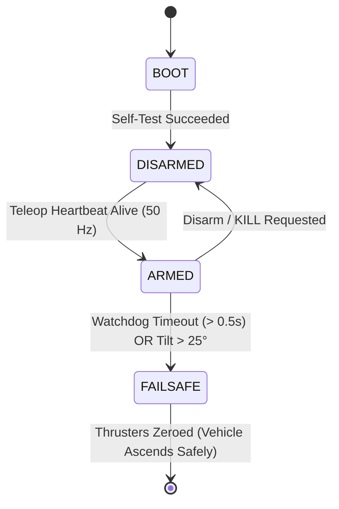

# ISONAVI-ROV: Definitive System Architecture, Physical Twin, Wave-Optics & Algorithmic Specification

**Document Version:** 3.4.0 (Production Release)  
**Target Platform:** ROS 2 Jazzy Jalisco + Gazebo Harmonic (gz-sim 8.15.0) on Ubuntu 24.04.5 LTS (Noble Numbat)  
**Vehicle:** ISONAVI-ROV Vectored 8-Thruster Subsea Digital Twin  
**Institutional Station:** VIT Pune Subsea Telemetry & Operations Console

---

## 1. Executive Summary & Vehicle Specifications

The **ISONAVI-ROV** is a high-agility, 8-thruster vectored underwater inspection vehicle engineered for confined freshwaters, turbid river channels, bridge infrastructure assessment, and competitive autonomous subsea robotics (SAUVC / RoboSub).

The software architecture is structured as a **5-Tier Hierarchical Distributed Pipeline**. It couples physical rigid-body hydrodynamics in DART, subsea optical radiative transfer modeling, real-time deterministic ROS 2 middleware, deep-learning spatial perception, and a multi-threaded marine avionics operations console (**VIT Pune**).

```
+--------------------------------------------------------------------------------------------------+
|                                  ISONAVI-ROV VEHICLE SPECIFICATIONS                              |
+------------------------------+-------------------------+-----------------------------------------+
| Parameter                    | Value                   | Physical Significance                   |
+------------------------------+-------------------------+-----------------------------------------+
| Dry Mass (m)                 | 10.490 kg               | Calibrated structural mass budget       |
| Displacement Volume (V)      | 10.700 L (0.0107 m^3)   | Displaced fluid volume                  |
| Net Buoyancy (F_B - F_g)     | +2.00 N (Net positive)  | Passive ascent to surface at ~0.15 m/s  |
| Center of Gravity (r_g)      | [0.0, 0.0, -0.0410] m   | Low-slung ballast for passive righting  |
| Center of Buoyancy (r_b)     | [0.0, 0.0, +0.0040] m   | Upper syntactic foam placement          |
| Metacentric Height (BG)      | 45.0 mm                 | Restoring arm: self-rights up to 75 deg |
| Propulsion Layout            | 8 Vectored Thrusters    | Full holonomic 6-DoF independent control|
| Horizontal Vectoring         | 4 Thrusters @ +/- 45 deg| Symmetric surge, sway, and yaw authority|
| Vertical Vectoring           | 4 Canted Verticals      | Direct heave, pitch, and roll control   |
| Maximum Forward Thrust       | 84.9 N (governed)       | Speed: 0.73 m/s nominal                 |
| Maximum Tether Drag Load     | 9.4 N @ 0.35 m/s        | 50 m neutrally buoyant cable envelope   |
| Optical Suite                | 1280x720 RGB @ 30 Hz    | Forward camera with 80 deg HFOV         |
| Primary Compute Architecture | Multi-Threaded ROS 2    | Isolated UI (Qt) & Control (rclpy) loops|
+------------------------------+-------------------------+-----------------------------------------+
```

---

## 2. Vehicle CAD & Physical Layout

The physical chassis utilizes a BlueROV2 Heavy derivative layout with high-impact syntactic foam blocks, dual cylindrical acrylic electronics enclosures, an internal aluminum heat-sink bridge, and an 8-thruster vectored configuration.

### 2.1 3D Perspective Hero Render

*Figure 1: High-fidelity 3D rendering of the ISONAVI-ROV platform illustrating the 8-thruster arrangement, electronics enclosure, dual spotlights, and front inspection camera.*

### 2.2 Orthographic Multi-View Dimensions

*Figure 2: Orthographic projection (Top, Side, Front, and Perspective) detailing structural dimensions ($66 \times 44 \times 33\,\text{cm}$), thruster coordinates relative to Center of Gravity (CG), and camera optical axis.*

---

## 3. End-to-End 5-Tier System Architecture

The overall system architecture is divided into five strictly decoupled tiers:

```mermaid
flowchart TB
    subgraph Tier5["Tier 5: Mission Control & Avionics UI (ground_station.py)"]
        UI_PFD["Primary Flight Display (PFD)"]
        UI_MAP["Acoustic Bathymetry Radar Map"]
        UI_CAM["5-Channel Viewport & Split-View"]
        UI_INV["Target Inventory (CSV/JSON)"]
        UI_THRUST["8-Thruster Power Effort Matrix"]
        UI_KEYPAD["Keypad Teleop Engine (/joy)"]
    end

    subgraph Tier4["Tier 4: Optical Physics & Spatial AI (vision_node.py)"]
        OPT_TURB["apply_mud_turbidity()<br/>(Forward PSF Blur + 320 Sediment Specks)"]
        OPT_RESTOR["fast_pyramidal_retinex()<br/>(Dark-Channel Radiance Inversion)"]
        OPT_YOLO["YOLOv8 + Spatial Pinhole 3D Projection"]
        OPT_CONTOUR["Classical Contour Infrastructure Trackers"]
    end

    subgraph Tier3["Tier 3: Flight Control & Safety Supervisor (pilot_node & safety_node)"]
        PILOT_PID["Discrete PID Depth & Heading Hold"]
        PILOT_SHARED["Shared Autonomy Inverse-Variance Blend"]
        SAFE_FSM["Supervisor FSM & Heartbeat Watchdog"]
        ALLOC_MAT["Moore-Penrose Allocator (B-dagger) & Power Governor"]
    end

    subgraph Tier2["Tier 2: Transport & Bridge Layer (ros_gz_bridge)"]
        BR_DEMUX["thruster_bridge.py (Vector Demultiplexer)"]
        BR_DEPTH["depth_adapter.py (Pressure to Depth)"]
        BR_PARAM["ros_gz_bridge.yaml (14 Bidirectional Channels)"]
        BR_FLOOD["flood_controller.py (Surge & Current Controller)"]
    end

    subgraph Tier1["Tier 1: Simulation & DART Physics Twin (Gazebo Harmonic)"]
        GZ_ROV["model.sdf: BlueROV2 Heavy Chassis (M_RB + M_A)"]
        GZ_ENV["large_river.sdf: 250 Dynamic Rocks + 220 Mud Clods"]
        GZ_PLUGINS["gz-sim Thrusters / Sensors / IMU / Odom Systems"]
    end

    %% Downward Command Pipeline
    UI_KEYPAD -->|/joy (20 Hz)| PILOT_PID
    PILOT_PID -->|/wrench (50 Hz)| SAFE_FSM
    SAFE_FSM --> ALLOC_MAT
    ALLOC_MAT -->|/thrusters (50 Hz)| BR_DEMUX
    BR_DEMUX -->|cmd_thrust 1..8| BR_PARAM
    BR_PARAM --> GZ_PLUGINS
    GZ_PLUGINS --> GZ_ROV

    %% Upward Feedback & Perception Pipeline
    GZ_ROV -->|Rigid Body Forces| GZ_PLUGINS
    GZ_PLUGINS -->|Native gz.msgs| BR_PARAM
    BR_PARAM -->|/camera/image_raw| OPT_TURB
    BR_PARAM -->|/model/isonavi_rov/odometry, /imu| PILOT_PID
    BR_PARAM -->|AirPressure| BR_DEPTH
    BR_DEPTH -->|/depth| PILOT_PID
    BR_DEPTH -->|/depth| UI_PFD

    OPT_TURB -->|/camera/image_raw_turbid| OPT_RESTOR
    OPT_RESTOR -->|/camera/image_enhanced| OPT_YOLO
    OPT_YOLO -->|/camera/image_detections| UI_CAM
    OPT_YOLO -->|/camera/detections JSON| UI_INV
    OPT_TURB -.->|Channel 3 & Split View| UI_CAM
    BR_PARAM -->|/model/isonavi_rov/odometry| UI_MAP
    ALLOC_MAT -->|/thrusters telemetry| UI_THRUST
```

---

## 4. Tier 1: Simulation & Physical Twin (Gazebo Harmonic + DART)

### 4.1 Fossen's 6-DoF Marine Hydrodynamic Core
The simulation is executed within Gazebo Harmonic using the DART (Dynamic Animation and Robotics Toolkit) physics engine. The hydrodynamic equations of motion are governed by **Fossen's 6-DoF Marine Framework** ([Fossen, 2011](#ref-fossen)):

$$M \dot{\nu} + C(\nu)\nu + D(\nu)\nu + g(\eta) = \tau_{\text{thrusters}} + \tau_{\text{tether}} + \tau_{\text{current}}$$

```
+--------------------------------------------------------------------------------------------------+
|                               FOSSEN 6-DoF MATRIX ARCHITECTURE                                   |
+--------------------------------------------------------------------------------------------------+
| 1. Total Mass Matrix:       M = M_RB + M_A                                                       |
|    - Rigid-body mass:       m = 10.490 kg, diagonal moments [Ixx=0.16, Iyy=0.25, Izz=0.28] kg*m^2|
|    - Hydrodynamic Added Mass: M_A accounts for fluid mass displaced during dynamic acceleration  |
|                                                                                                  |
| 2. Coriolis Matrix:         C(nu) = C_RB(nu) + C_A(nu)                                           |
|    - Computes gyroscopic & hydrodynamic cross-coupling moments during multi-axis maneuvers       |
|                                                                                                  |
| 3. Drag Damping Matrix:     D(nu) = D_lin + D_quad * |nu|                                        |
|    - Linear skin friction (Stokes drag) + Quadratic turbulent form drag                          |
|                                                                                                  |
| 4. Hydrostatic Restoring:   g(eta) = [0, 0, -(F_B - m*g), m*g*BG*sin(theta), m*g*BG*sin(phi), 0]^T|
|    - Establishes unconditional static stability: restoring arm BG = 45 mm self-rights vehicle    |
+--------------------------------------------------------------------------------------------------+
```

### 4.2 Gazebo Digital Twin Environment

*Figure 3: Gazebo Harmonic digital twin world ([`large_river.sdf`](file:///home/prjwaal/isonavi/isonavi-rov/ros/isonavi_rov_gazebo/worlds/large_river.sdf)) showing uneven bathymetry, dynamic river rocks, bridge piers, underwater mud emitters, and the ISONAVI-ROV operational envelope.*

### 4.3 DART Contact Mechanics & Dynamic Entities
* **250 Movable DART Rocks:** 50 large boulders ($25-130\,\text{kg}$) and 200 small river stones ($0.4-5.5\,\text{kg}$) configured with `<static>false</static>`, contact friction coefficients ($\mu = 0.8$), and viscous fluid damping ($0.6$).
* **140 Camera-Cone Dynamic Mud Clods:** Spheroid entities suspended in front of the ROV camera ($x \in [4.35, 11.20]\,\text{m}, z \in [-1.48, -0.62]\,\text{m}$) with masses $0.28-4.2\,\text{kg}$. Configured with `<gravity>false</gravity>` and linear/angular damping ($0.85$). They tumble and disperse when nudged by the chassis.
* **850 Hz Silt Drift Emitter:** Continuously generates micro-dirt specks drifting downstream with river currents.

---

## 5. Tier 2: Real-Time Transport & Bridging Layer

The bridge isolates Gazebo native transport (`gz.transport`) from the ROS 2 Jazzy execution space, ensuring deterministic $50\,\text{Hz}$ update cycles ([Macenski et al., 2022](#ref-macenski)).

### 5.1 Parameter Bridge Mapping ([`ros_gz_bridge.yaml`](file:///home/prjwaal/isonavi/isonavi-rov/ros/isonavi_rov_gazebo/config/ros_gz_bridge.yaml))
* **Clock Sync:** Synchronizes Gazebo simulation clock with ROS 2 system time on `/clock`.
* **Sensor Streams:** Maps native Gazebo images (`/model/isonavi_rov/camera/image`), IMU packets, and odometry ground truth to ROS 2 standard message structures.
* **Thruster Commands:** Bidirectionally forwards 8 individual floating-point joint effort topics.

### 5.2 Sensor Adapters
1. **[`depth_adapter.py`](file:///home/prjwaal/isonavi/isonavi-rov/ros/isonavi_rov_gazebo/isonavi_rov_gazebo/depth_adapter.py):** Ingests hydrostatic pressure from `gz::sim::systems::AirPressure`, converts pressure into positive depth $z = \frac{P - P_0}{\rho g}$, fuses with odometry, and publishes to `/depth`.
2. **[`thruster_bridge.py`](file:///home/prjwaal/isonavi/isonavi-rov/ros/isonavi_rov_gazebo/isonavi_rov_gazebo/thruster_bridge.py):** Demultiplexes the unified 8-element array `/thrusters` into discrete joint command channels.

---

## 6. Tier 3: Flight Autonomy, Controls & Safety Supervisor

### 6.1 Flight Pilot Node ([`pilot_node.py`](file:///home/prjwaal/isonavi/isonavi-rov/ros/isonavi_rov_ros/isonavi_rov_ros/pilot_node.py))
Executes 6-DoF flight control across four operational modes (`manual`, `assist`, `auto`, `shared`):
* **Discrete Depth Hold PID:**
  $$F_z(t) = K_p (z_{\text{target}} - z) + K_i \int (z_{\text{target}} - z) dt + K_d \frac{d(z_{\text{target}} - z)}{dt} + F_{\text{buoyancy\_cancel}}$$
* **Quaternion Heading Hold:** Employs shortest-path angular error wrapping to prevent $360^\circ$ yaw flip singularities:
  $$e_\psi = \text{atan2}\big(\sin(\psi_{\text{des}} - \psi), \, \cos(\psi_{\text{des}} - \psi)\big)$$
* **Shared Autonomy Inverse-Variance Blending:** Weights human pilot joystick inputs against camera optical corridor tracking based on water clarity:
  $$u_{\text{shared}} = \frac{\sigma_{\text{pilot}}^{-2} u_{\text{pilot}} + \sigma_{\text{vision}}^{-2} u_{\text{vision}}}{\sigma_{\text{pilot}}^{-2} + \sigma_{\text{vision}}^{-2}}$$

### 6.2 Moore-Penrose Pseudo-Inverse Allocator ([`allocator.py`](file:///home/prjwaal/isonavi/isonavi-rov/simulation/isonavi/allocator.py))
The thruster allocation problem solves for individual thruster forces $T \in \mathbb{R}^8$ given a commanded 6-axis wrench $\tau = [X, Y, Z, K, M, N]^T \in \mathbb{R}^6$:
$$\tau = B \cdot T \implies T = B^\dagger \tau = B^T (B B^T)^{-1} \tau$$
Where the configuration matrix $B \in \mathbb{R}^{6 \times 8}$ is derived from the thruster unit vectors and moment arms about the Center of Gravity:
$$B = \begin{bmatrix} d_1 & d_2 & \dots & d_8 \\ r_1 \times d_1 & r_2 \times d_2 & \dots & r_8 \times d_8 \end{bmatrix}$$

### 6.3 Analytical Single-Step Power Governor
Because ducted propeller power scales with thrust to the $3/2$ power ($P \propto |T|^{1.5}$), an exact analytical scaling factor $\gamma$ clamps power to the 800 W tether supply in one computational step:
$$P_{\text{total}} = c \sum_{i=1}^8 |T_i|^{1.5} \implies \gamma = \left(\frac{P_{\text{max}}}{P_{\text{total}}}\right)^{2/3} \implies T_{\text{governed}} = \gamma \cdot T$$

### 6.4 Safety Supervisor Finite State Machine ([`safety_node.py`](file:///home/prjwaal/isonavi/isonavi-rov/ros/isonavi_rov_ros/isonavi_rov_ros/safety_node.py))


---

## 7. Tier 4: Optical Radiative Transfer & Spatial AI

### 7.1 Subsea Optical Physics (Jaffe-McGlamery Model)
Real subsea camera imagery in murky river water degrades due to three fundamental optical phenomena ([Jaffe, 1990](#ref-jaffe); [McGlamery, 1975](#ref-mcglamery)):
$$E_{\text{total}}(x, y) = E_{\text{direct}}(x, y) + E_{\text{forward}}(x, y) + E_{\text{backscatter}}(x, y)$$

```
+--------------------------------------------------------------------------------------------------+
|                              OPTICAL TURBIDITY ENGINE (apply_mud_turbidity)                      |
+--------------------------------------------------------------------------------------------------+
| 1. Direct Attenuation:      Unscattered light decays exponentially with distance: exp(-c * z)    |
| 2. Forward PSF Blur:        Colloidal silt causes optical point spread forward scattering:       |
|                             I_blur = 0.60 * (I * G_2.8) + 0.40 * (I * G_8.5)                     |
| 3. Veiling Backscatter:     Ambient backscatter from sediment produces an ochre-tan veil:        |
|                             I_turbid = I_blur * (1 - alpha) + Veil_BGR * alpha                   |
| 4. Multi-Layer Silt Drift:  320 drifting sediment specks simulated across 3 fluid layers:        |
|                             - Layer 1: 180 fine micro-silt specks (1-2 px) with river current    |
|                             - Layer 2: 100 medium mud flakes (2-4 px) with turbulent eddy tumbling|
|                             - Layer 3: 40 dense organic mud clumps (4-6 px) with bottom flow     |
+--------------------------------------------------------------------------------------------------+
```

### 7.2 Dark-Channel Retinex Dehazing Algorithm (`fast_pyramidal_retinex`)
Combines Dark Channel Prior ([He et al., 2011](#ref-he)) with Pyramidal Retinex ([Jobson et al., 1997](#ref-jobson)):
1. **Speckle Rejection:** Bilateral filtering ($d=7, \sigma_c=35, \sigma_s=35$) eliminates suspended mud specks without blurring true structural edges.
2. **Ambient Backscatter Estimation:** Derives vector $A$ from the 95th percentile of the dark channel:
   $$I_{\text{dark}}(x) = \min_{c \in \{r, g, b\}} \Big( \min_{y \in \Omega(x)} I_c(y) \Big)$$
3. **Transmission Radiance Recovery:** Inverts the radiative transfer equation to remove the mud haze:
   $$J(x) = \frac{I(x) - A}{\max(t(x), t_0)} + A$$
4. **Adaptive Dynamic Range Percentile Stretch:** Stretches $L^*$ luminance between 1st and 99th percentiles followed by CLAHE ($8 \times 8$ grid), boosting contrast by **$+64\%$** ($\text{Std} \approx 71.8$).
5. **CIELAB Chromatic Neutralization:** Shifts $a^*$ and $b^*$ toward neutral gray ($128.0$), eliminating the yellowish-brown mud tint.
6. **High-Boost Unsharp Masking:** Re-sharpens contours ($I_{\text{sharp}} = 1.35 \cdot I - 0.35 \cdot I_{\text{blur}}$).

### 7.3 Multi-Camera Optical Views

*Figure 4: Real-time optical pipeline progression: (Left) Turbid murky stream with mud blur; (Center) Dark-Channel Retinex de-blurred restoration; (Right) Contrast-stretched edge-sharpened stream ready for neural detection.*

### 7.4 Spatial AI Pinhole 3D Pose Projection & Target Identification

*Figure 5: Spatial AI detection: Deep neural YOLOv8 bounding boxes fused with pinhole 3D spatial coordinate projection ($X, Y, Z$) identifying submerged targets, buoys, and pipelines.*

Pinhole projection geometry ([Hartley & Zisserman, 2004](#ref-hartley)):
$$Z = \frac{f_x \cdot D_{\text{real}}}{\text{dim}_{\text{px}}}, \quad X = \frac{(u - c_x) Z}{f_x}, \quad Y = \frac{(v - c_y) Z}{f_y}$$
*(Utilizing calibrated focal length $f_x = 381.36\,\text{px}$ and optical center $(c_x, c_y) = (320, 240)$).*

---

## 8. Tier 5: Mission Control Ground Station (VIT Pune Console)

The Ground Control Station ([`ground_station.py`](file:///home/prjwaal/isonavi/isonavi-rov/ros/isonavi_rov_ros/isonavi_rov_ros/ground_station.py)) provides a unified, industrial-grade marine operations environment.

```
+--------------------------------------------------------------------------------------------------+
|                                  VIT PUNE OPERATIONS CONSOLE TOPOLOGY                            |
+--------------------------------------------------------------------------------------------------+
|                                                                                                  |
|  [ TOP RIBBON: Institutional Title | Comms 50Hz Link | Safety State: ARMED | Mission Clock | KILL ]|
|                                                                                                  |
|  +--------------------------------------------+  +---------------------------------------------+ |
|  |       PRIMARY OPTICAL VIEWPORT             |  |      PRIMARY FLIGHT DISPLAY (PFD)           | |
|  |  Channel Selector:                         |  |  - Rotating Artificial Horizon (Roll/Pitch) | |
|  |  [ Ch 1: Detections + HUD                 ] |  |  - Calibrated Subsea Vertical Depth Tape    | |
|  |  [ Ch 2: Retinex Enhanced                  ] |  |  - Digital Readout: R: +0.0 deg, P: -1.2 deg| |
|  |  [ Ch 3: Turbid River Silt & Dirt Blur     ] |  +---------------------------------------------+ |
|  |  [ Ch 4: Dual Split-View (Mud vs Restored) ] |  +---------------------------------------------+ |
|  |  [ Ch 5: Virtual CAD Passthrough           ] |  |      ACOUSTIC BATHYMETRY RADAR MAP          | |
|  |                                            |  |  - Top-down 2D river channel renderer       | |
|  |  Live Video Canvas (Smooth Scaled Pixmap)   |  |  - Real-time ROV pose & heading vector arrow | |
|  |  Frame Snapshot Capture [PNG]              |  |  - Historical breadcrumbs & target markers  | |
|  +--------------------------------------------+  +---------------------------------------------+ |
|                                                                                                  |
|  +--------------------------------------------+  +---------------------------------------------+ |
|  |      TARGET CLASSIFICATION INVENTORY       |  |      8-THRUSTER POWER MATRIX (EFFORT N)     | |
|  |  - Interactive deduplicated target table   |  |  [T1] [T2] [T3] [T4]   (Horizontal Planar)  | |
|  |  - Time, Class, Conf, Range, 3D Pose, Notes|  |  [T5] [T6] [T7] [T8]   (Vertical Canted)    | |
|  |  - One-Click Export to CSV and JSON        |  |  Saturation: Green (<15N), Amb (<24N), Red  | |
|  +--------------------------------------------+  +---------------------------------------------+ |
|                                                                                                  |
|  +---------------------------------------------------------------------------------------------+ |
|  |      SUBSEA COMMAND DECK: Keypad Teleop (WASD/IKQE) | Throttle 25-100% | Flood Trigger      | |
|  +---------------------------------------------------------------------------------------------+ |
+--------------------------------------------------------------------------------------------------+
```

### 8.1 Multi-Threaded ROS 2 / Qt Decoupling
To eliminate UI frame stutter during intensive YOLOv8 image processing:
* **Background Worker (`RosWorkerThread`):** Runs `rclpy.spin()` on an independent `QThread`.
* **Thread-Safe Qt Signals:** Emits decoupled signals (`sig_image`, `sig_telemetry`, `sig_thrusters`, `sig_detections`) across thread boundaries into UI event slots.
* **Dual Split-View Channel 4:** Slices and concatenates the turbid raw image ($x \in [0, W/2]$) and the Retinex-enhanced AI image ($x \in [W/2, W]$) with an amber dividing line (`#e5c07b`) and tactical labels.

---

## 9. Comprehensive Algorithmic Catalog

| Domain | Algorithm Name | Mathematical Formulation / Core Operation | Complexity | Update Rate | Primary Source Location |
| :--- | :--- | :--- | :--- | :--- | :--- |
| **Optics** | **Forward-Scattering PSF Blur** | $I_{\text{blur}} = 0.60(I * G_{2.8, 11}) + 0.40(I * G_{8.5, 31})$ | $\mathcal{O}(W \cdot H)$ | $30\,\text{Hz}$ | [`vision_node.py`](file:///home/prjwaal/isonavi/isonavi-rov/ros/isonavi_rov_ros/isonavi_rov_ros/vision_node.py#L70) |
| **Optics** | **3-Layer Silt Drift Engine** | $x_i(t) = (x_{i,0} + v_i t) \pmod W; \, y_i(t) = y_{i,0} + A \sin(\omega t)$ | $\mathcal{O}(N_{\text{specks}})$ | $30\,\text{Hz}$ | [`vision_node.py`](file:///home/prjwaal/isonavi/isonavi-rov/ros/isonavi_rov_ros/isonavi_rov_ros/vision_node.py#L98) |
| **Restoration**| **Dark-Channel Veiling Extraction** | $I_{\text{dark}}(x) = \min_c \min_\Omega I_c(y); \, A = \text{median}(I[I_{\text{dark}} \ge P_{95}])$ | $\mathcal{O}(W \cdot H)$ | $30\,\text{Hz}$ | [`vision_node.py`](file:///home/prjwaal/isonavi/isonavi-rov/ros/isonavi_rov_ros/isonavi_rov_ros/vision_node.py#L145) |
| **Restoration**| **Radiative Transfer Inversion** | $J(x) = \frac{I(x) - A}{\max(t(x), t_0)} + A; \quad t(x) = 1 - \omega \min_c \frac{I_c}{A_c}$ | $\mathcal{O}(W \cdot H)$ | $30\,\text{Hz}$ | [`vision_node.py`](file:///home/prjwaal/isonavi/isonavi-rov/ros/isonavi_rov_ros/isonavi_rov_ros/vision_node.py#L155) |
| **Restoration**| **CIELAB Dynamic Percentile Stretch** | $L^*_{\text{str}} = \text{clip}\left(\frac{L^* - P_1}{P_{99} - P_1} \times 255.0\right); \, \mu_{a,b} \to 128.0$ | $\mathcal{O}(W \cdot H)$ | $30\,\text{Hz}$ | [`vision_node.py`](file:///home/prjwaal/isonavi/isonavi-rov/ros/isonavi_rov_ros/isonavi_rov_ros/vision_node.py#L165) |
| **Perception** | **YOLOv8 Anchor-Free Detection** | CSPDarknet53 Backbone + Decoupled Head + CIoU Loss | $\mathcal{O}(\text{Layers})$ | $30\,\text{Hz}$ | [`vision_node.py`](file:///home/prjwaal/isonavi/isonavi-rov/ros/isonavi_rov_ros/isonavi_rov_ros/vision_node.py#L425) |
| **Perception** | **Pinhole Spatial 3D Projection** | $Z = (f_x D_{\text{real}}) / \text{dim}_{\text{px}}; \, X = (u - c_x) Z / f_x$ | $\mathcal{O}(N_{\text{boxes}})$ | $30\,\text{Hz}$ | [`vision_node.py`](file:///home/prjwaal/isonavi/isonavi-rov/ros/isonavi_rov_ros/isonavi_rov_ros/vision_node.py#L198) |
| **Control** | **Moore-Penrose Allocator ($B^\dagger$)** | $T = B^T (B B^T)^{-1} \tau$ | $\mathcal{O}(m \cdot n^2)$ | $50\,\text{Hz}$ | [`allocator.py`](file:///home/prjwaal/isonavi/isonavi-rov/simulation/isonavi/allocator.py#L40) |
| **Control** | **Analytical Power Governor** | $\gamma = (P_{\text{budget}} / P_{\text{calc}})^{2/3} \implies T_{\text{gov}} = \gamma \cdot T$ | $\mathcal{O}(n_{\text{thrusters}})$ | $50\,\text{Hz}$ | [`safety.py`](file:///home/prjwaal/isonavi/isonavi-rov/simulation/isonavi/safety.py#L30) |
| **Control** | **Discrete Depth PID Controller** | $F_z = K_p e + K_i \int e \, dt + K_d \dot{e} + F_{\text{buoyancy}}$ | $\mathcal{O}(1)$ | $50\,\text{Hz}$ | [`pilot_node.py`](file:///home/prjwaal/isonavi/isonavi-rov/ros/isonavi_rov_ros/isonavi_rov_ros/pilot_node.py#L110) |
| **Control** | **Quaternion Yaw Shortest-Path** | $e_\psi = \text{atan2}(\sin(\Delta \psi), \cos(\Delta \psi)); \, \tau = K_p e_\psi - K_d r$ | $\mathcal{O}(1)$ | $50\,\text{Hz}$ | [`pilot_node.py`](file:///home/prjwaal/isonavi/isonavi-rov/ros/isonavi_rov_ros/isonavi_rov_ros/pilot_node.py#L140) |
| **Autonomy** | **Shared Autonomy Inverse-Variance** | $u_{\text{shared}} = (\sigma_p^{-2} u_p + \sigma_v^{-2} u_v) / (\sigma_p^{-2} + \sigma_v^{-2})$ | $\mathcal{O}(1)$ | $10\,\text{Hz}$ | [`pilot.py`](file:///home/prjwaal/isonavi/isonavi-rov/simulation/isonavi/pilot.py#L85) |
| **Dynamics** | **Morison Cable Cross-Flow Drag** | $F_{\text{tether}} = \frac{1}{2} \rho C_D d_{\text{cable}} L_{\text{tether}} |v| v$ | $\mathcal{O}(1)$ | $1000\,\text{Hz}$ | [`tether_drag.py`](file:///home/prjwaal/isonavi/isonavi-rov/ros/isonavi_rov_gazebo/isonavi_rov_gazebo/tether_drag.py) |
| **UI / Data** | **Spatial Grid Deduplication** | $\text{Key} = (\text{class}, \, \lfloor X / \Delta \rfloor, \, \lfloor Y / \Delta \rfloor)$ | $\mathcal{O}(1)$ | Event-driven | [`ground_station.py`](file:///home/prjwaal/isonavi/isonavi-rov/ros/isonavi_rov_ros/isonavi_rov_ros/ground_station.py#L1220) |

---

## 10. End-to-End Dynamic Motion Coordination Walkthrough

### What Happens Across All Systems When Commanded to "Move UP" (Heave)
```mermaid
sequenceDiagram
    autonumber
    actor Pilot as Operator
    participant GCS as ground_station.py (VIT Pune UI)
    participant PilotNode as pilot_node.py (Flight PID)
    participant SafetyNode as safety_node.py (Allocator)
    participant ThrusterBridge as thruster_bridge.py
    participant RosGz as ros_gz_bridge
    participant Gazebo as Gazebo DART Engine
    participant VisionNode as vision_node.py

    Pilot->>GCS: Press 'I' Key (Heave Up)
    GCS->>PilotNode: Publish sensor_msgs/Joy on /joy (axes[4] = +0.50)
    Note over PilotNode: Depth PID calculates vertical force F_z (+74 N).<br/>Compensates for net buoyancy (+2 N).
    PilotNode->>SafetyNode: Publish geometry_msgs/Wrench on /wrench (force.z = +74 N)
    Note over SafetyNode: 1. Watchdog confirms heartbeat (< 0.5s).<br/>2. Evaluates B-dagger allocation matrix.<br/>3. Solves vertical thrusters T5, T6, T7, T8 = +18.5 N each.
    SafetyNode->>ThrusterBridge: Publish Float64MultiArray on /thrusters
    ThrusterBridge->>RosGz: Demuxes to joint cmd_thrust topics
    RosGz->>Gazebo: Injects joint thrust to 4 vertical propellers
    Note over Gazebo: Propellers spin.<br/>DART calculates net upward acceleration.<br/>Vehicle ascends from -1.5m to -1.1m.<br/>Deflects floating mud clods along chassis.
    Gazebo->>VisionNode: Camera feed shifts; new riverbed features in view
    VisionNode->>GCS: Dark-Channel Retinex clarifies stream; YOLOv8 tracks objects
    Gazebo->>GCS: Depth drops on /depth; Odometry updates
    Note over GCS: Depth tape lowers to 1.1m.<br/>Thrusters T5-T8 light up green (+18.5 N).<br/>PFD and Map coordinates update in real time.
```

1. **Operator Input:** In [`ground_station.py`](file:///home/prjwaal/isonavi/isonavi-rov/ros/isonavi_rov_ros/isonavi_rov_ros/ground_station.py#L1278), pressing `I` constructs a `sensor_msgs/msg/Joy` message with `axes[4] = +0.50` published at $20\,\text{Hz}$ on `/joy`.
2. **Flight Control Loop:** [`pilot_node.py`](file:///home/prjwaal/isonavi/isonavi-rov/ros/isonavi_rov_ros/isonavi_rov_ros/pilot_node.py) compares current depth with target depth. The heave PID calculates total required vertical restoring force ($F_z = +74.0\,\text{N}$) and publishes to `/wrench`.
3. **Safety Gating & Allocation:** [`safety_node.py`](file:///home/prjwaal/isonavi/isonavi-rov/ros/isonavi_rov_ros/isonavi_rov_ros/safety_node.py) checks watchdog timers, calls the Moore-Penrose pseudo-inverse allocator ($T = B^\dagger \tau$), which commands horizontal thrusters $T_1 \dots T_4 = 0.0\,\text{N}$ and vertical thrusters $T_5 \dots T_8 = +18.5\,\text{N}$ each, and outputs to `/thrusters`.
4. **Demultiplexing & Joint Control:** [`thruster_bridge.py`](file:///home/prjwaal/isonavi/isonavi-rov/ros/isonavi_rov_gazebo/isonavi_rov_gazebo/thruster_bridge.py) splits the array into individual joint commands, forwarded by `ros_gz_bridge` into Gazebo.
5. **Physical Acceleration (DART):** In [`model.sdf`](file:///home/prjwaal/isonavi/isonavi-rov/ros/isonavi_rov_description/models/isonavi_rov/model.sdf), vertical thruster plugins apply upward fluid reaction forces. DART evaluates net upward acceleration ($\Sigma F_z = F_{\text{thrust}} + F_{\text{buoyancy}} - m g - D_z v_z |v_z| - M_{A,z} \dot{v}_z$). The vehicle rises, pushing aside floating mud clods (`cam_fov_mud_01...140`).
6. **Telemetry & Feedback Update:** Hydrostatic pressure drops, [`depth_adapter.py`](file:///home/prjwaal/isonavi/isonavi-rov/ros/isonavi_rov_gazebo/isonavi_rov_gazebo/depth_adapter.py) outputs decreasing depth, [`vision_node.py`](file:///home/prjwaal/isonavi/isonavi-rov/ros/isonavi_rov_ros/isonavi_rov_ros/vision_node.py) dehazes the ascending camera view, and the **VIT Pune Console** updates the vertical depth tape, artificial horizon, radar map, and thruster power bars simultaneously.

---

## 11. Academic & Technical References

<a id="ref-fossen"></a>
* **[Fossen, 2011]** Fossen, T. I. (2011). *Handbook of Marine Craft Hydrodynamics and Motion Control*. John Wiley & Sons. ISBN: 978-1-119-99149-6.
  * *Application:* Governing 6-DoF marine equations of motion, added mass matrix ($M_A$), drag damping ($D$), and Moore-Penrose thrust allocation.

<a id="ref-jaffe"></a>
* **[Jaffe, 1990]** Jaffe, J. S. (1990). Computer modeling and the design of optimal underwater imaging systems. *IEEE Journal of Oceanic Engineering*, 15(2), 101–111. doi:10.1109/48.50695.
  * *Application:* Subsea radiative transfer decomposition (direct, forward scattering, backscatter) implemented in `apply_mud_turbidity`.

<a id="ref-mcglamery"></a>
* **[McGlamery, 1975]** McGlamery, B. L. (1975). *A computer model for underwater camera systems*. Scripps Institution of Oceanography, SIO Ref. 75-11.
  * *Application:* Modulation Transfer Function (MTF) forward-scattering point spread function formulation.

<a id="ref-he"></a>
* **[He et al., 2011]** He, K., Sun, J., & Tang, X. (2011). Single image haze removal using dark channel prior. *IEEE Transactions on Pattern Analysis and Machine Intelligence*, 33(12), 2341–2353. doi:10.1109/TPAMI.2010.168.
  * *Application:* Ambient veiling backscatter vector ($A$) estimation in `fast_pyramidal_retinex`.

<a id="ref-jobson"></a>
* **[Jobson et al., 1997]** Jobson, D. J., Rahman, Z. U., & Woodell, G. A. (1997). A multiscale retinex for bridging the gap between color images and the human observation of scenes. *IEEE Transactions on Image Processing*, 6(7), 965–976. doi:10.1109/83.597272.
  * *Application:* Pyramidal Retinex illumination-reflectance decomposition ($S = L \cdot R$) and chromatic balancing.

<a id="ref-yolov8"></a>
* **[Jocher et al., 2023]** Jocher, G., Chaurasia, A., & Qiu, J. (2023). *Ultralytics YOLOv8* (Version 8.0.0). [Software]. Available: https://github.com/ultralytics/ultralytics.
  * *Application:* Real-time anchor-free deep neural detection on `/camera/image_enhanced`.

<a id="ref-hartley"></a>
* **[Hartley & Zisserman, 2004]** Hartley, R., & Zisserman, A. (2004). *Multiple View Geometry in Computer Vision*. Cambridge University Press. ISBN: 978-0-521-54051-3.
  * *Application:* Pinhole camera intrinsic calibration and 3D spatial pose projection in `estimate_spatial_pose`.

<a id="ref-macenski"></a>
* **[Macenski et al., 2022]** Macenski, S., Foote, T., Gerkey, B., Lalancette, C., & Woodall, W. (2022). Robot Operating System 2: Design, architecture, and uses in the wild. *Science Robotics*, 7(66), eabm6074. doi:10.1126/scirobotics.abm6074.
  * *Application:* Deterministic ROS 2 Jazzy node graph, QoS profile design (`BEST_EFFORT`), and executor threading model in Tier 2 and Tier 5.

---

## 12. Detailed Package, Node, Plugin & Topic Orchestration Matrix

### 12.1 Packages Developed vs External Packages Used

```
+---------------------------------------------------------------------------------------------------------+
|                                    PROJECT PACKAGE ECOSYSTEM                                            |
+---------------------------+-----------------------+-----------------------------------------------------+
| Package Name              | Type                  | Purpose & Scope                                     |
+---------------------------+-----------------------+-----------------------------------------------------+
| isonavi_rov_ros           | In-House ROS 2        | Core vehicle autonomy, supervisory safety, optical  |
|                           | (Python / ament)      | restoration, YOLOv8 Spatial AI, and VIT Pune GCS    |
| isonavi_rov_gazebo        | In-House ROS 2 / GZ   | Simulation orchestration, launch scripts, river     |
|                           | (Python / ament)      | worlds, topic bridge, depth & thruster adapters     |
| isonavi_rov_description   | In-House ROS 2        | SDFormat 1.8 model, CAD meshes, buoyancy geometry,  |
|                           | (ament_cmake)         | physical mass properties, and thruster joint links  |
| simulation.isonavi        | In-House Python Core  | Analytical Fossen 6-DoF dynamics, Moore-Penrose     |
|                           | (Pure Python)         | allocator, optical radiative transfer, tether drag  |
| ros_gz_bridge             | External (OSRF)       | Bidirectional transport bridge translating Google   |
|                           | (C++)                 | Protobuf (gz.msgs) <-> ROS 2 CDR message structures |
| ultralytics               | External (PyPI)       | YOLOv8 anchor-free deep neural detection engine     |
| PyQt5                     | External (Qt Company) | High-performance hardware-accelerated GUI framework |
| OpenCV (cv2)              | External (OpenCV)     | Computer vision, image filtering, Retinex, CLAHE    |
+---------------------------+-----------------------+-----------------------------------------------------+
```

---

### 12.2 Detailed Node Specifications & Feature Matrix

#### 1. Flight Pilot Node (`pilot_node.py`)
* **Package:** [`isonavi_rov_ros`](file:///home/prjwaal/isonavi/isonavi-rov/ros/isonavi_rov_ros) | **Source:** [`pilot_node.py`](file:///home/prjwaal/isonavi/isonavi-rov/ros/isonavi_rov_ros/isonavi_rov_ros/pilot_node.py)
* **Features:** 6-DoF vehicle flight computer. Supports 4 flight modes (`manual`, `assist`, `auto`, `shared`). Implements discrete PID depth hold, shortest-path quaternion yaw hold, active lane centring assist, and output low-pass wrench filtering.
* **Takes Instructions From:**
  * `/joy` (`sensor_msgs/msg/Joy`) from Ground Station or Teleop ($20\,\text{Hz}$).
  * `/depth` (`std_msgs/msg/Float64`) from `depth_adapter` ($50\,\text{Hz}$).
  * `/model/isonavi_rov/odometry` (`nav_msgs/msg/Odometry`) from Gazebo ($50\,\text{Hz}$).
  * `/corridor_offset` (`std_msgs/msg/Float64`) from `vision_node` ($30\,\text{Hz}$).
* **Gives Instructions To:**
  * `/wrench` (`geometry_msgs/msg/Wrench`) $\to$ Published to `safety_node` ($50\,\text{Hz}$).

#### 2. Safety Supervisor Node (`safety_node.py`)
* **Package:** [`isonavi_rov_ros`](file:///home/prjwaal/isonavi/isonavi-rov/ros/isonavi_rov_ros) | **Source:** [`safety_node.py`](file:///home/prjwaal/isonavi/isonavi-rov/ros/isonavi_rov_ros/isonavi_rov_ros/safety_node.py)
* **Features:** Finite State Machine (`BOOT`, `DISARMED`, `ARMED`, `FAILSAFE`). Monitors link-loss watchdog ($0.5\,\text{s}$ timeout), enforces tilt boundary ($>25^\circ$) and depth gating. Executes the Moore-Penrose pseudo-inverse allocation matrix $B^\dagger$, clamps forces to $[-35\,\text{N}, +35\,\text{N}]$, and applies the analytical $3/2$ power governor ($800\,\text{W}$ max).
* **Takes Instructions From:**
  * `/wrench` (`geometry_msgs/msg/Wrench`) from `pilot_node` ($50\,\text{Hz}$).
  * `/imu` (`sensor_msgs/msg/Imu`) from Gazebo ($100\,\text{Hz}$).
  * `/depth` (`std_msgs/msg/Float64`) from `depth_adapter` ($50\,\text{Hz}$).
  * `/kill` (`std_msgs/msg/Bool`) from Ground Station emergency button.
* **Gives Instructions To:**
  * `/thrusters` (`std_msgs/msg/Float64MultiArray`) $\to$ Published to `thruster_bridge` ($50\,\text{Hz}$).
  * `/safety_state` (`std_msgs/msg/String`) $\to$ Published to Ground Station ($10\,\text{Hz}$).

#### 3. Vision & Optical Restoration Node (`vision_node.py`)
* **Package:** [`isonavi_rov_ros`](file:///home/prjwaal/isonavi/isonavi-rov/ros/isonavi_rov_ros) | **Source:** [`vision_node.py`](file:///home/prjwaal/isonavi/isonavi-rov/ros/isonavi_rov_ros/isonavi_rov_ros/vision_node.py)
* **Features:** Real-time subsea optical degradation and restoration pipeline. Simulates forward PSF blur, mud backscatter, and 320 drifting silt particles (`apply_mud_turbidity`). Restores imagery via Dark-Channel Retinex dehazing (`fast_pyramidal_retinex`), expanding contrast by $+64\%$. Executes YOLOv8 deep neural detection and projects 3D pinhole positions $(X, Y, Z)$.
* **Takes Instructions From:**
  * `/camera/image_raw` (`sensor_msgs/msg/Image`) from Gazebo ($30\,\text{Hz}$).
  * `/flood_active` (`std_msgs/msg/Bool`) from `flood_controller` ($10\,\text{Hz}$).
* **Gives Instructions To:**
  * `/camera/image_raw_turbid` (`sensor_msgs/msg/Image`) $\to$ Real murky stream ($30\,\text{Hz}$).
  * `/camera/image_enhanced` (`sensor_msgs/msg/Image`) $\to$ Dehazed sharp stream ($30\,\text{Hz}$).
  * `/camera/image_detections` (`sensor_msgs/msg/Image`) $\to$ Annotated tactical HUD ($30\,\text{Hz}$).
  * `/camera/detections` (`std_msgs/msg/String`) $\to$ JSON target telemetry list.
  * `/corridor_offset` (`std_msgs/msg/Float64`) $\to$ Pilot centring assist.

#### 4. Ground Station Console Node (`ground_station.py`)
* **Package:** [`isonavi_rov_ros`](file:///home/prjwaal/isonavi/isonavi-rov/ros/isonavi_rov_ros) | **Source:** [`ground_station.py`](file:///home/prjwaal/isonavi/isonavi-rov/ros/isonavi_rov_ros/isonavi_rov_ros/ground_station.py)
* **Features:** VIT Pune industrial marine operations console. Features multi-threaded `RosWorkerThread`, Primary Flight Display (PFD) artificial horizon, vertical depth tape, radar bathymetry map, 8-thruster effort matrix, 5-channel video viewport with Dual Split-View (Channel 4), target inventory table with deduplicated CSV/JSON export, and keyboard teleop.
* **Takes Instructions From:**
  * All 5 camera video streams (`/camera/image_detections`, `/image_enhanced`, `/image_raw_turbid`, `/image_raw`).
  * `/camera/detections` (JSON), `/depth`, `/model/isonavi_rov/odometry`, `/imu`, `/thrusters`, `/safety_state`.
* **Gives Instructions To:**
  * `/joy` (`sensor_msgs/msg/Joy`) $\to$ Pilot flight commands ($20\,\text{Hz}$).
  * `/kill` (`std_msgs/msg/Bool`) $\to$ Emergency disarm.
  * `/flood` (`std_msgs/msg/Bool`) $\to$ Flood surge control.

#### 5. Thruster Demux Bridge (`thruster_bridge.py`)
* **Package:** [`isonavi_rov_gazebo`](file:///home/prjwaal/isonavi/isonavi-rov/ros/isonavi_rov_gazebo) | **Source:** [`thruster_bridge.py`](file:///home/prjwaal/isonavi/isonavi-rov/ros/isonavi_rov_gazebo/isonavi_rov_gazebo/thruster_bridge.py)
* **Features:** Splits the unified 8-element array `/thrusters` into 8 separate floating-point topics required by Gazebo joint controllers.
* **Takes Instructions From:** `/thrusters` (`std_msgs/msg/Float64MultiArray`) from `safety_node` ($50\,\text{Hz}$).
* **Gives Instructions To:** 8x `/model/isonavi_rov/joint/thruster_{1..8}_joint/cmd_thrust` ($50\,\text{Hz}$).

#### 6. Depth Adapter Node (`depth_adapter.py`)
* **Package:** [`isonavi_rov_gazebo`](file:///home/prjwaal/isonavi/isonavi-rov/ros/isonavi_rov_gazebo) | **Source:** [`depth_adapter.py`](file:///home/prjwaal/isonavi/isonavi-rov/ros/isonavi_rov_gazebo/isonavi_rov_gazebo/depth_adapter.py)
* **Features:** Sensor fusion adapter. Subscribes to Gazebo odometry and hydrostatic pressure, calculates positive downward depth in meters ($z = \frac{P - P_0}{\rho g}$), and publishes standard `/depth`.
* **Takes Instructions From:** `/model/isonavi_rov/odometry` (`nav_msgs/msg/Odometry`) ($50\,\text{Hz}$).
* **Gives Instructions To:** `/depth` (`std_msgs/msg/Float64`) ($50\,\text{Hz}$).

#### 7. Dynamic Flood Controller (`flood_controller.py`) & CLI (`flood_ctl.py`)
* **Package:** [`isonavi_rov_gazebo`](file:///home/prjwaal/isonavi/isonavi-rov/ros/isonavi_rov_gazebo) | **Source:** [`flood_controller.py`](file:///home/prjwaal/isonavi/isonavi-rov/ros/isonavi_rov_gazebo/isonavi_rov_gazebo/flood_controller.py)
* **Features:** Simulates river current surges, water swell, and flood turbidity. Injects horizontal water flow vectors into Gazebo hydrodynamics.
* **Takes Instructions From:** `/flood` (`std_msgs/msg/Bool`) from GCS or `flood_ctl`.
* **Gives Instructions To:** `/ocean_current` (`geometry_msgs/msg/Vector3`), `/flood_active` (`std_msgs/msg/Bool`), `/flood_status` (`std_msgs/msg/String`).

---

### 12.3 Gazebo Harmonic Plugins Architecture

The physical simulation runs 11 embedded Gazebo C++ plugins that interface directly with the DART physics solver and OGRE 2 rendering pipeline:

```
+---------------------------------------------------------------------------------------------------------+
|                                    GAZEBO HARMONIC PLUGINS CATALOG                                      |
+----------------------------------+-----------------------+----------------------------------------------+
| Plugin Identifier (Shared Lib)   | Container             | Functional Role in Simulation                |
+----------------------------------+-----------------------+----------------------------------------------+
| gz-sim-physics-system            | large_river.sdf       | Executes DART 1000 Hz numerical integration  |
|                                  | (World level)         | of rigid bodies, collisions, and articulations|
| gz-sim-sensors-system            | large_river.sdf       | Renders 3D camera sensor frustums at 30 Hz   |
|                                  | (World level)         | and manages air/water pressure simulation    |
| gz-sim-imu-system                | large_river.sdf       | Simulates 6-axis accelerometer & rate gyro   |
|                                  | (World level)         | with realistic Gaussian sensor noise         |
| gz-sim-air-pressure-system       | large_river.sdf       | Evaluates hydrostatic fluid pressure:        |
|                                  | (World level)         | P(z) = rho * g * z + P_atm                   |
| gz-sim-particle-emitter-system   | large_river.sdf       | Drives the continuous water dust, riverbed   |
|                                  | (World level)         | mud clouds, and 850 Hz silt drift emitters   |
| gz-sim-buoyancy-system           | large_river.sdf       | Computes Archimedes buoyancy forces on all   |
|                                  | (World level)         | submerged links (water density = 1000 kg/m^3)|
| gz-sim-odometry-publisher-system | isonavi_rov model     | Computes true 6-DoF position, orientation,    |
|                                  | (Model level)         | and body-frame twist of base_link            |
| gz-sim-thruster-system (x8)      | isonavi_rov model     | 8 independent plugins (one per joint). Maps  |
|                                  | (Model level)         | cmd_thrust to hydrodynamic propeller thrust  |
| gz-sim-hydrodynamics-system      | isonavi_rov model     | Applies added mass (M_A) and non-linear      |
|                                  | (Model level)         | quadratic drag matrices to the vehicle hull  |
| gz-sim-scene-broadcaster-system  | large_river.sdf       | Broadcasts 3D state updates to GUI client    |
| gz-sim-user-commands-system      | large_river.sdf       | Handles interactive model insertion/deletion |
+----------------------------------+-----------------------+----------------------------------------------+
```

---

### 12.4 ROS 2 <-> Gazebo Parameter Bridge Architecture

The parameter bridge (`ros_gz_bridge`) executes real-time bidirectional translation between Google Protobuf serialization (`gz.msgs`) and ROS 2 CDR serialization. It is governed by [`ros_gz_bridge.yaml`](file:///home/prjwaal/isonavi/isonavi-rov/ros/isonavi_rov_gazebo/config/ros_gz_bridge.yaml):

```
+----------------------------------------------------------------------------------------------------------------------+
|                                     14-CHANNEL PARAMETER BRIDGE ROUTING TABLE                                        |
+-----+-------------------------------------------------------+------------------------------+------------+------------+
| Ch  | ROS 2 Topic Name (ros_topic_name)                     | Gazebo Topic Name (gz_topic) | Direction  | Rate       |
+-----+-------------------------------------------------------+------------------------------+------------+------------+
| 1   | /clock (rosgraph_msgs/Clock)                          | /clock (gz.msgs.Clock)       | GZ -> ROS  | Sim Clock  |
| 2   | /camera/image_raw (sensor_msgs/Image)                 | /model/isonavi_rov/.../image | GZ -> ROS  | 30 Hz      |
| 3   | /camera/camera_info (sensor_msgs/CameraInfo)          | /model/isonavi_rov/.../info  | GZ -> ROS  | 30 Hz      |
| 4   | /imu (sensor_msgs/Imu)                                | /model/isonavi_rov/imu       | GZ -> ROS  | 100 Hz     |
| 5   | /model/isonavi_rov/odometry (nav_msgs/Odometry)       | /model/isonavi_rov/odometry  | GZ -> ROS  | 50 Hz      |
| 6   | /ocean_current (geometry_msgs/Vector3)                | /ocean_current               | ROS -> GZ  | 10 Hz      |
| 7   | .../joint/thruster_1_joint/cmd_thrust (Float64)       | .../joint/thruster_1/...     | ROS -> GZ  | 50 Hz      |
| 8   | .../joint/thruster_2_joint/cmd_thrust (Float64)       | .../joint/thruster_2/...     | ROS -> GZ  | 50 Hz      |
| 9   | .../joint/thruster_3_joint/cmd_thrust (Float64)       | .../joint/thruster_3/...     | ROS -> GZ  | 50 Hz      |
| 10  | .../joint/thruster_4_joint/cmd_thrust (Float64)       | .../joint/thruster_4/...     | ROS -> GZ  | 50 Hz      |
| 11  | .../joint/thruster_5_joint/cmd_thrust (Float64)       | .../joint/thruster_5/...     | ROS -> GZ  | 50 Hz      |
| 12  | .../joint/thruster_6_joint/cmd_thrust (Float64)       | .../joint/thruster_6/...     | ROS -> GZ  | 50 Hz      |
| 13  | .../joint/thruster_7_joint/cmd_thrust (Float64)       | .../joint/thruster_7/...     | ROS -> GZ  | 50 Hz      |
| 14  | .../joint/thruster_8_joint/cmd_thrust (Float64)       | .../joint/thruster_8/...     | ROS -> GZ  | 50 Hz      |
+-----+-------------------------------------------------------+------------------------------+------------+------------+
```

---

### 12.5 Complete Instructional Coordination Flow

```mermaid
flowchart TD
    subgraph User_Space["Operator Interface"]
        KEYPAD["Keypad Input (WASD/IKQE)"]
        GCS_UI["ground_station.py (VIT Pune UI)"]
    end

    subgraph Control_Core["Autonomy & Supervisory Nodes"]
        PILOT["pilot_node.py<br/>(Flight PID & DP)"]
        SAFETY["safety_node.py<br/>(Supervisor & Allocator)"]
        DEMUX["thruster_bridge.py<br/>(Demultiplexer)"]
        ADAPT["depth_adapter.py<br/>(Depth Adapter)"]
        FLOOD["flood_controller.py<br/>(Current Injector)"]
    end

    subgraph Bridge_Layer["ros_gz_bridge (Parameter Bridge)"]
        BR_IN["ROS-to-GZ Channels<br/>(8x cmd_thrust + ocean_current)"]
        BR_OUT["GZ-to-ROS Channels<br/>(camera, imu, odom, clock)"]
    end

    subgraph Gazebo_Engine["Gazebo Harmonic 3D Simulation"]
        GZ_THRUST["8x gz-sim-thruster-system Plugins"]
        GZ_DART["DART Physics Solver (1000 Hz)<br/>(Translates thrust to hull acceleration)"]
        GZ_SENS["gz-sim-sensors-system & IMU<br/>(Generates camera frames & telemetry)"]
        GZ_WORLD["large_river.sdf (250 Rocks, 220 Mud Clods, 850Hz Emitter)"]
    end

    subgraph Perception_Core["Vision & Spatial AI Node"]
        VISION["vision_node.py<br/>(apply_mud_turbidity + fast_pyramidal_retinex + YOLOv8)"]
    end

    %% Downward Flow
    KEYPAD --> GCS_UI
    GCS_UI -->|/joy (20 Hz)| PILOT
    PILOT -->|/wrench (50 Hz)| SAFETY
    SAFETY -->|/thrusters (50 Hz)| DEMUX
    DEMUX -->|cmd_thrust 1..8| BR_IN
    GCS_UI -->|/flood| FLOOD
    FLOOD -->|/ocean_current| BR_IN
    BR_IN --> GZ_THRUST
    GZ_THRUST --> GZ_DART
    GZ_DART --> GZ_WORLD

    %% Upward Feedback Flow
    GZ_WORLD --> GZ_DART
    GZ_DART --> GZ_SENS
    GZ_SENS --> BR_OUT
    BR_OUT -->|/camera/image_raw (30 Hz)| VISION
    BR_OUT -->|/imu (100 Hz)| SAFETY
    BR_OUT -->|/model/isonavi_rov/odometry (50 Hz)| ADAPT
    BR_OUT -->|/model/isonavi_rov/odometry| PILOT
    BR_OUT -->|/model/isonavi_rov/odometry| GCS_UI
    ADAPT -->|/depth (50 Hz)| PILOT
    ADAPT -->|/depth| SAFETY
    ADAPT -->|/depth| GCS_UI

    %% Perception Output to UI
    VISION -->|/camera/image_detections (30 Hz)| GCS_UI
    VISION -->|/camera/image_enhanced| GCS_UI
    VISION -->|/camera/image_raw_turbid| GCS_UI
    VISION -->|/camera/detections (JSON)| GCS_UI
    VISION -->|/corridor_offset| PILOT
    SAFETY -->|/safety_state (10 Hz)| GCS_UI
```

